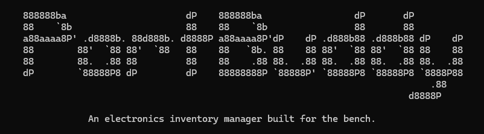

<div align="center">
  


[](.github/LICENSE.md)
[](https://isocpp.org/std/the-standard)
[](https://github.com/Meridian-devs/PartBuddy/stargazers)


[📖 Documentation]() | [⭐ Support Us]() | [🤝 Contributing](.github/CONTRIBUTING.md)

</div>

## PartBuddy
### Your electronic components, organized.
PartBuddy is an electronic component inventory management tool designed for electronics enthusiasts, makers, and engineers.

Managing an electronics collection can quickly become difficult. Components accumulate, part numbers get forgotten, datasheets become hard to find, and keeping track of what you have on hand becomes a project of its own.

PartBuddy aims to make component management simpler by bringing inventory tracking and technical component information into one place.

Developed by Meridian, PartBuddy is built to help you spend less time organizing components and more time building.

## Features
PartBuddy is being developed with the following capabilities in mind:
  - Component Inventory — Maintain a centralized catalog of your electronic components.
  - Component Lookup — Retrieve technical information using a component's part number.
  - Inventory Tracking — Keep track of quantities and storage locations.
  - Technical Documentation — Access datasheets and other relevant component information.
  - Search & Organization — Find components quickly using part numbers, manufacturers, categories, and other attributes.
  - Simplified Data Entry — Reduce repetitive manual entry by automatically retrieving component metadata where available.

PartBuddy is currently under development. Features and functionality are subject to change.

## Why PartBuddy?
Whether you're working on a breadboard prototype, designing a PCB, or maintaining a personal component collection, knowing what parts you have, and where to find them, is essential.

PartBuddy is designed to provide a straightforward way to catalog components, keep inventory organized, and make technical information easier to access.

The goal is simple: **make managing electronic components as intuitive as using them.**

## Getting Started
PartBuddy is currently in active development. Installation and usage instructions will be added as the project becomes ready for use.

For now, you can follow the development of the project through this repository.

## Roadmap
PartBuddy is being developed incrementally, with an emphasis on building a reliable foundation before expanding its functionality.

Planned development includes:
  - Core inventory management
  - Component lookup integration
  - Component metadata and datasheet retrieval
  - Inventory search and filtering
  - Persistent inventory storage
  - Improved component organization and management

The roadmap may evolve as development progresses and new ideas are explored.

## Development

### Project Structure

```
PartBuddy/
├── LICENSE                        GPL3.0 License for PartBuddy
├── CMakeLists.txt                 CMake config file for building
├── .gitignore                     gitignore file for PartBuddy 
├── src/                           Core utilities
│   ├── main.cpp                       Main logic loop
│   ├── Component.cpp                  Component structure and functionality
│   ├── Inventory.cpp                   
│   └── CLI.cpp                         
├── include/                       Libraries and include files
│   ├── Component.hpp                   Component structure and functionality
│   ├── Inventory.hpp                   Functions for Inventory
│   └── CLI.hpp                         Functions for CLI
├── examples/                      PartBuddy usage examples
├── tests/                         Tests for PartBuddy
├── documentation/                 Documentation
├── .github/                       GitHub templates and workflows
|   ├── README.md                      README file for PartBuddy 
│   ├── CONTRIBUTING.md                Contributing information
|   ├── media/                         Media for README.md 
│   ├── ISSUE_TEMPLATE/                Issue templates
│   └── pull_request_template.md           PR template
```

## Contributing
PartBuddy is developed as part of Meridian's broader collection of software and hardware projects.

As the project matures, contribution guidelines and development documentation will be made available.

#### Issue Templates

We provide several issue templates to help you report bugs, request features, or suggest documentation improvements:

- [🐛 Bug Report](.github/ISSUE_TEMPLATE/bug_report.md)
- [💡 Feature Request](.github/ISSUE_TEMPLATE/feature_request.md)
- [📖 Documentation](.github/ISSUE_TEMPLATE/documentation.md)

## License
PartBuddy is free and open-source software licensed under the GNU General Public License v3.0 (GPL-3.0) - see the [LICENSE](LICENSE.md) for full the full license text.

You are free to use, study, modify, and distribute PartBuddy in accordance with the terms of the license. If you distribute modified versions of the software, 
you must comply with the GPL-3.0 requirements, including providing the corresponding source code under the same license.

<div align="center">

**[⭐ Star us on GitHub](https://github.com/Meridian-devs/PartBuddy)** • **[📝 Contribute](.github/CONTRIBUTING.md)** • **[🐛 Report Bug](.github/ISSUE_TEMPLATE/bug_report.md)** • **[💡 Request Feature](.github/ISSUE_TEMPLATE/feature_request.md)**

Made with ❤️ by the Meridian team

</div>
